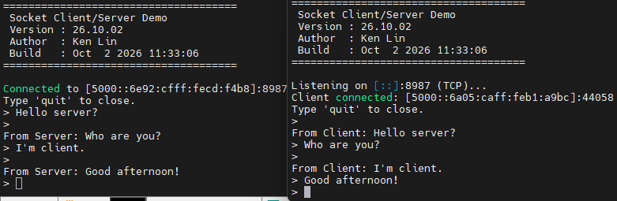

# ken_socket

A small, modular point-to-point chat tool written in C with the Berkeley Socket API. Two Linux hosts can talk to each other over **TCP or UDP**, and the **IPv4/IPv6 family is detected automatically** from the address you type.

## Features

- TCP or UDP, selected with a command-line option
- IPv4 / IPv6 auto-detection from the given IP (no `-4` / `-6` flag needed), including IPv6 link-local addresses with a scope ID (e.g. `fe80::1%eth0`)
- Dual-stack server: by default one socket accepts both IPv4 and IPv6 clients
- Single-threaded chat loop built on `poll()`: send and receive at the same time, and the session ends immediately when the peer disconnects
- Application-level `quit` command, so TCP and UDP sessions end the same way
- Modular design: protocol, address handling, argument parsing and chat logic are separate modules

## Demo



## Requirements

- Linux
- `gcc` and `make`

## Build

```bash
make
```

This compiles `src/*.c` into `build/` and produces the `ken_socket` executable. Header dependencies are tracked automatically, so editing a `.h` file rebuilds the affected sources.

```bash
make clean      # remove build/ and the executable
make deploy     # optional: copy the binary to a network share (uses powershell.exe, WSL/Windows only)
```

## Usage

```
./ken_socket -s [-t tcp|udp] [-p port] [-b bind_ip]
./ken_socket -c <server_ip> [-t tcp|udp] [-p port]
```

| Option | Description |
|---|---|
| `-s`, `--server` | Run as server |
| `-c`, `--client <ip>` | Run as client and connect to `<ip>` (IPv4 or IPv6, numeric address only) |
| `-t`, `--proto <tcp\|udp>` | Transport protocol (default: `tcp`) |
| `-p`, `--port <port>` | Port number (default: `8787`) |
| `-b`, `--bind <ip>` | Server only: bind to a specific address (default: all interfaces, dual-stack) |
| `-h`, `--help` | Show help |

Exactly one of `-s` or `-c` is required.

### Examples

```bash
# TCP over IPv4
./ken_socket -s                          # host A
./ken_socket -c 192.168.0.10             # host B

# TCP over IPv6 (family detected from the address)
./ken_socket -s                          # host A
./ken_socket -c 5000::6a05:caff:feb1:a9bc    # host B

# UDP on a custom port
./ken_socket -s -t udp -p 9000
./ken_socket -c ::1 -t udp -p 9000

# Server listening on IPv6 loopback only
./ken_socket -s -b ::1
```

### In a session

Type a message and press Enter to send it. Type `quit` (or press Ctrl-D) to end the session. The peer is notified and leaves the session as well. After a session ends, the server goes back to waiting for the next client; press Ctrl-C to stop the server.

## Project structure

```
.
├── Makefile
├── include/
│   ├── ks_common.h      # shared types, constants, enums
│   ├── ks_args.h        # command-line parsing
│   ├── ks_addr.h        # IP family detection, address resolution, formatting
│   ├── ks_transport.h   # transport abstraction (ops table)
│   └── ks_chat.h        # chat loop
├── src/
│   ├── main.c           # banner -> parse args -> pick transport -> run
│   ├── ks_args.c        # getopt_long based parsing and validation
│   ├── ks_addr.c        # getaddrinfo / getnameinfo wrappers
│   ├── ks_tcp.c         # TCP implementation of the transport ops
│   ├── ks_udp.c         # UDP implementation of the transport ops
│   ├── ks_transport.c   # selects the ops table by protocol
│   └── ks_chat.c        # poll() loop, protocol independent
└── tests/
    ├── test_addr.c      # address detection / resolution checks
    └── test_tcp.c       # minimal one-shot exchange
```

## Architecture

```
main
 ├─ ks_args       command line      -> ks_config_t {mode, proto, ip, port}
 ├─ ks_addr       IP string         -> family (IPv4/IPv6) + sockaddr
 ├─ ks_transport  ops table (function pointers)
 │     ├─ ks_tcp  socket / connect / listen / accept / send / recv
 │     └─ ks_udp  socket / bind / connect / recvfrom / send / recv
 └─ ks_chat       poll(stdin, socket) loop; only calls ops->send / ops->recv
```

The chat logic knows nothing about TCP/UDP or IPv4/IPv6. Each protocol implements the same set of operations:

```c
typedef struct {
    int     (*open_client)(ks_endpoint_t *ep, const ks_config_t *cfg);
    int     (*open_server)(ks_endpoint_t *ep, const ks_config_t *cfg);
    int     (*wait_peer)  (ks_endpoint_t *ep);   // TCP: accept; UDP: first datagram
    ssize_t (*send)       (ks_endpoint_t *ep, const void *buf, size_t len);
    ssize_t (*recv)       (ks_endpoint_t *ep, void *buf, size_t len);
    void    (*close)      (ks_endpoint_t *ep);
} ks_transport_ops_t;
```

Adding another protocol means adding one `.c` file that provides an ops table and registering it in `ks_transport.c`.

### Design notes

- **Address handling**: `getaddrinfo()` with `AI_NUMERICHOST` is used instead of `inet_pton()`, so IPv6 scope IDs work. Addresses are stored in `sockaddr_storage`, and shown with `getnameinfo()`. IPv4-mapped IPv6 addresses (`::ffff:a.b.c.d`) are displayed as plain IPv4.
- **Dual-stack server**: when no bind address is given, the server binds `::` with `IPV6_V6ONLY` disabled, and falls back to `0.0.0.0` if IPv6 is unavailable.
- **TCP**: `send()` loops until the whole buffer is written and retries on `EINTR`; `MSG_NOSIGNAL` avoids `SIGPIPE`.
- **UDP**: the client `connect()`s its socket to the server and sends an empty datagram so the server learns the client's address. The server `connect()`s to the first sender, so the kernel filters packets from other sources. An empty datagram is treated as "no data", not as a disconnect.
- **Why `poll()`**: keyboard and socket are watched in one place, so there is no second thread to wake up when the session ends, and no shared state to protect. For two file descriptors, `poll()` is sufficient; `epoll` would only pay off with many concurrent connections.

## Testing

Build and run the small test programs from the project root:

```bash
gcc -Wall -Wextra -Iinclude tests/test_addr.c src/ks_addr.c -o test_addr
./test_addr 192.168.0.240 ::1 fe80::1%lo ::ffff:1.2.3.4 abc 999.1.1.1

gcc -Wall -Wextra -Iinclude tests/test_tcp.c src/ks_args.c src/ks_addr.c \
    src/ks_tcp.c src/ks_udp.c src/ks_transport.c -o test_tcp
./test_tcp -s            # terminal A
./test_tcp -c 127.0.0.1  # terminal B
```

### Inspecting traffic

```bash
ss -tlnp | grep ken_socket                 # TCP listeners
ss -ulnp | grep ken_socket                 # UDP sockets
tcpdump -i eth0 -nn -X 'port 8787 and not port 22'
```

What to expect on the wire:

- **TCP**: three-way handshake, `[P.]` packets carrying your text, `[F.]` on close.
- **UDP**: a zero-length datagram when the client starts, then one datagram per message. If no server is listening, an ICMP "port unreachable" comes back and the client reports `Connection refused`.

`nc` is handy as a reference peer:

```bash
nc -l 8787              # TCP server (IPv4)
nc -6 -l 8787           # TCP server (IPv6)
nc -u -l 8787           # UDP server
```

## Limitations

- One peer at a time; a new client is accepted only after the current session ends.
- Only numeric IP addresses are accepted by `-c` (no hostname lookup).
- TCP has no message framing: two messages sent back-to-back may arrive in a single read. This is fine for interactive typing but not for bulk data.
- Messages are limited to 1023 bytes per read (`KS_BUF_SIZE`).
- UDP has no connection state: if a client is killed without sending `quit`, the server is not notified until its next send fails.

## Author

Ken Lin
